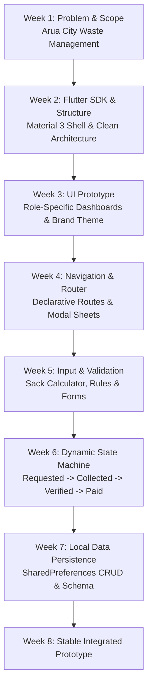

# Week 8 Milestone Brief: Mid-Semester Working Prototype Review

## 1. Prototype Overview
By Week 8, EcoRoute unified all foundational mobile development milestones (Weeks 1 through 7) into a stable, cohesive, offline-first working prototype. The prototype demonstrates the complete end-to-end user lifecycle across all three primary user personas: Resident, Rider, and Municipal Administrator.

---

## 2. Integrated Feature Matrix (Weeks 1 – 7)

### Key Components Integrated:
1. **Domain Entities & State Machine (`lib/domain/`):**
   - Formal transition rules in `status_machine.dart` enforcing that requests only move forward legitimately (`requested` $\to$ `collected` $\to$ `awaitingVerification` $\to$ `paid` or `cancelled`).
   - Business pricing rules in `price_calculator.dart` enforcing minimum (1) and maximum (50) sack boundaries.
   - Spatial zone resolver (`zone_resolver.dart`) utilizing Euclidean distance formulas to verify coordinates within the 12 km Arua boundary.
2. **Persistence Engine (`lib/core/`):**
   - `SharedPreferencesPickupRequestRepository` with JSON serialization, schema migrations, and corrupt data resilience.
3. **Responsive UI & Forms (`lib/features/`):**
   - `OrderPage` with reactive form validation and dynamic price calculation.
   - `AuthSheet` enabling instant role-switching between Resident, Rider, and Administrator.
   - `EcoRouteHomeScreen` with `IndexedStack` preserving navigation state across Home, Requests, and Profile tabs.

---

## 3. Core End-to-End User Journey Demonstration
1. **Resident Action:**
   - Resident logs in via demo credentials or registers.
   - Navigates to **REPORT AN ISSUE** / **Schedule pickup**.
   - Selects waste type (e.g. Household), specifies 4 sacks.
   - System calculates cost: `4 × 1,500 UGX = 6,000 UGX`.
   - Form validates that description is $\ge 10$ characters and phone number is present.
   - Order is submitted $\to$ saved locally in `SharedPreferences` $\to$ immediately prepended to local request list.
2. **Rider Action:**
   - User switches role to **Rider**.
   - Dashboard automatically switches to **Rider dispatch board**.
   - Rider inspects "Today's route" and views the newly submitted stop.
   - Taps **Mark collected** $\to$ status moves to `collected`.
   - Taps **Send for verification** $\to$ status moves to `awaitingVerification`.
3. **Administrator Action:**
   - User switches role to **Admin**.
   - Dashboard switches to **Operations control center**.
   - The approval queue displays the pending stop.
   - Admin taps **Approve payment** $\to$ status transitions to `paid`.
   - Real-time **Transaction Analytics** bar chart immediately updates verified counts.

---

## 4. Codebase Refactoring & Housekeeping
- **Elimination of Redundant Code:** Removed duplicate template folders (`lib/android` and `lib/ios`) that had been inadvertently duplicated into the `lib/` directory.
- **ParentData & Flex Bug Fixes:** Resolved RenderFlex constraints and parent data conflicts on narrow viewports ($< 360$ dp and $412 \times 700$ dp).
- **Test Suite Integrity:** All unit and widget tests pass 100% with `flutter test`.
