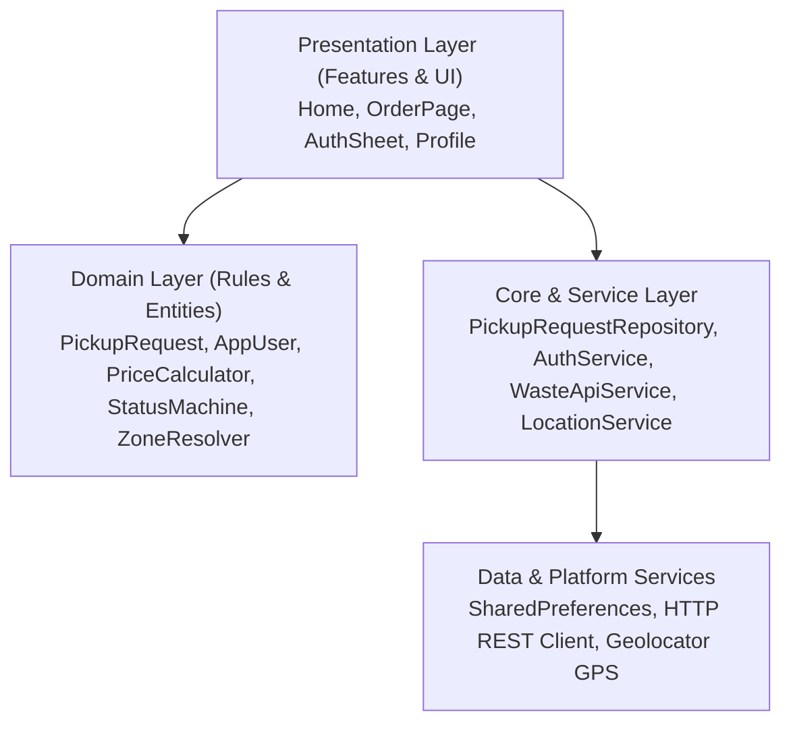
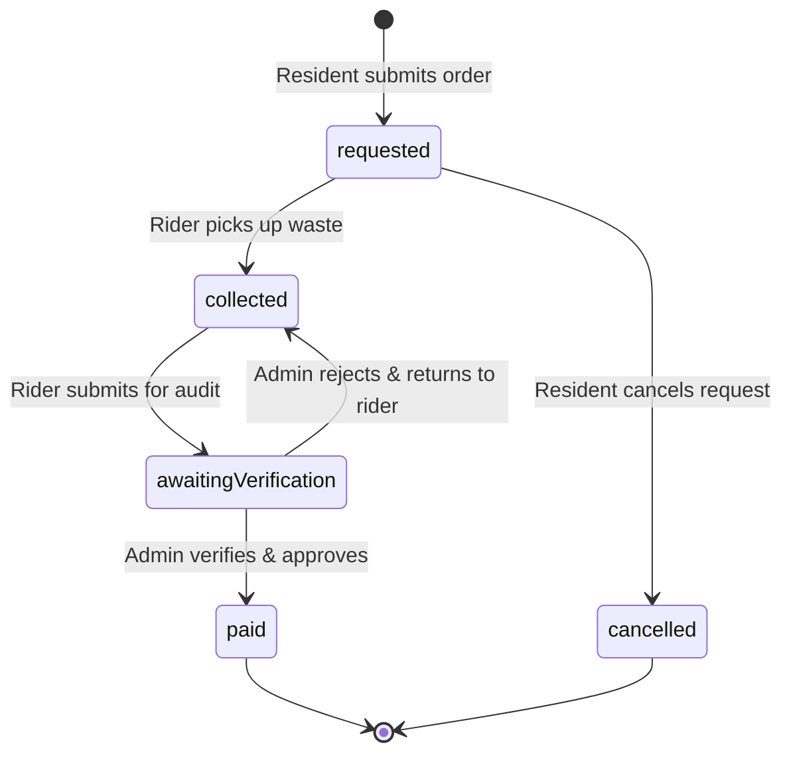

# Technical Documentation: EcoRoute System Architecture

## 1. System Architecture Overview
EcoRoute is engineered using Clean Architecture principles, ensuring strict separation of concerns across presentation, business domain logic, and data storage/networking layers.



### Directory Structure:
```
ecoRoute/
├── lib/
│   ├── app/                    # Application shell, router, and themes
│   │   ├── config/             # Constants (Arua coordinates, schedules, tariffs)
│   │   ├── theme/              # Material 3 typography and green color palette
│   │   ├── app.dart            # EcoRouteApp entry widget
│   │   └── router.dart         # Named routing and navigation generator
│   ├── core/                   # Infrastructure, services, and repositories
│   │   ├── services/           # WasteApiService (REST), AuthService, LocationService
│   │   ├── utils/              # UGX formatters and string helpers
│   │   ├── pickup_request_repository.dart # Local storage CRUD
│   │   └── result.dart         # Sealed Result monad for error handling
│   ├── domain/                 # Pure Dart business rules and entities
│   │   ├── entities/           # PickupRequest, AppUser
│   │   ├── enums/              # RequestStatus, Role, WasteType, Zone
│   │   └── rules/              # PriceCalculator, ReminderPolicy, StatusMachine, ZoneResolver
│   ├── features/               # Presentation screens & modular components
│   │   ├── auth/               # Role switcher and registration bottom sheet
│   │   ├── home/               # Dashboard, route queue, admin approval, weather card
│   │   └── request/            # Order creation with live pricing and GPS autofill
│   └── main.dart               # App entrypoint with async dependency initialization
├── test/                       # 26 automated unit, mock, and widget tests
└── docs/                       # Complete project, test, and defence documentation
```

---

## 2. Domain Data Models & Entities

### `PickupRequest` Model:
| Field | Type | Description |
| :--- | :--- | :--- |
| `id` | `String` | Unique microsecond timestamp identifier |
| `wasteType` | `WasteType` | `household`, `tradingCenter`, `unknown` |
| `description` | `String` | Pickup location details and description ($\ge 10$ chars) |
| `sackCount` | `int` | Number of sacks to collect ($1 \le n \le 50$) |
| `priceUgx` | `int` | Total computed collection fee in Uganda Shillings |
| `zone` | `Zone` | `north`, `south`, `east`, `west` |
| `address` | `String` | Physical landmark or division name |
| `latitude` / `longitude` | `double?` | GPS coordinates acquired via Geolocator |
| `residentName` / `residentPhone` | `String` | Contact details for pickup coordination |
| `status` | `RequestStatus` | `requested`, `collected`, `awaitingVerification`, `paid`, `cancelled` |

---

## 3. Finite State Machine Transitions



---

## 4. REST API Integration (`WasteApiService`)
- **Endpoint:** `https://api.open-meteo.com/v1/forecast?latitude=3.05&longitude=30.91&current_weather=true`
- **Method:** `HTTP GET` with 4-second timeout.
- **Payload Parsing:** Extracts `temperature`, `windspeed`, and WMO `weathercode`.
- **Business Logic:** Codes $51 \le c \le 99$ signify active rain or showers, triggering warning banners about impassable unpaved roads in Arua.
- **Failover Mechanism:** Returns offline cached guidelines whenever a `SocketException`, `TimeoutException`, or HTTP non-200 occurs.

---

## 5. Device Capability Integration (`LocationService`)
- **Package:** `geolocator: ^14.1.2`
- **Platform Configuration:** Configured in `AndroidManifest.xml`:
  - `android.permission.INTERNET`
  - `android.permission.ACCESS_FINE_LOCATION`
  - `android.permission.ACCESS_COARSE_LOCATION`
- **Permission Flow:** Checks `isLocationServiceEnabled()`, requests permissions dynamically (`checkPermission()` / `requestPermission()`), and handles permanent denials gracefully without application disruption.
- **Spatial Resolution:** Resolves distance using Haversine approximation from center $(3.05^\circ, 30.91^\circ)$. If distance $\le 12$ km, calculates vector angle to assign Cardinal Zone.
