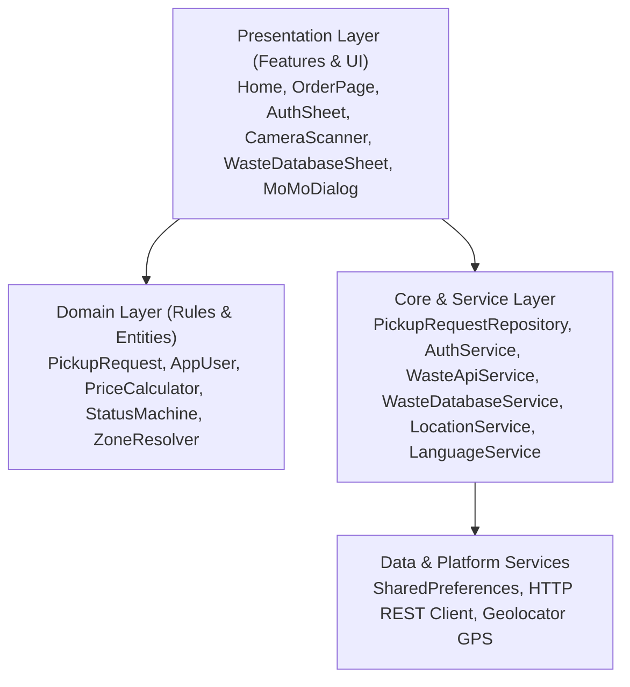
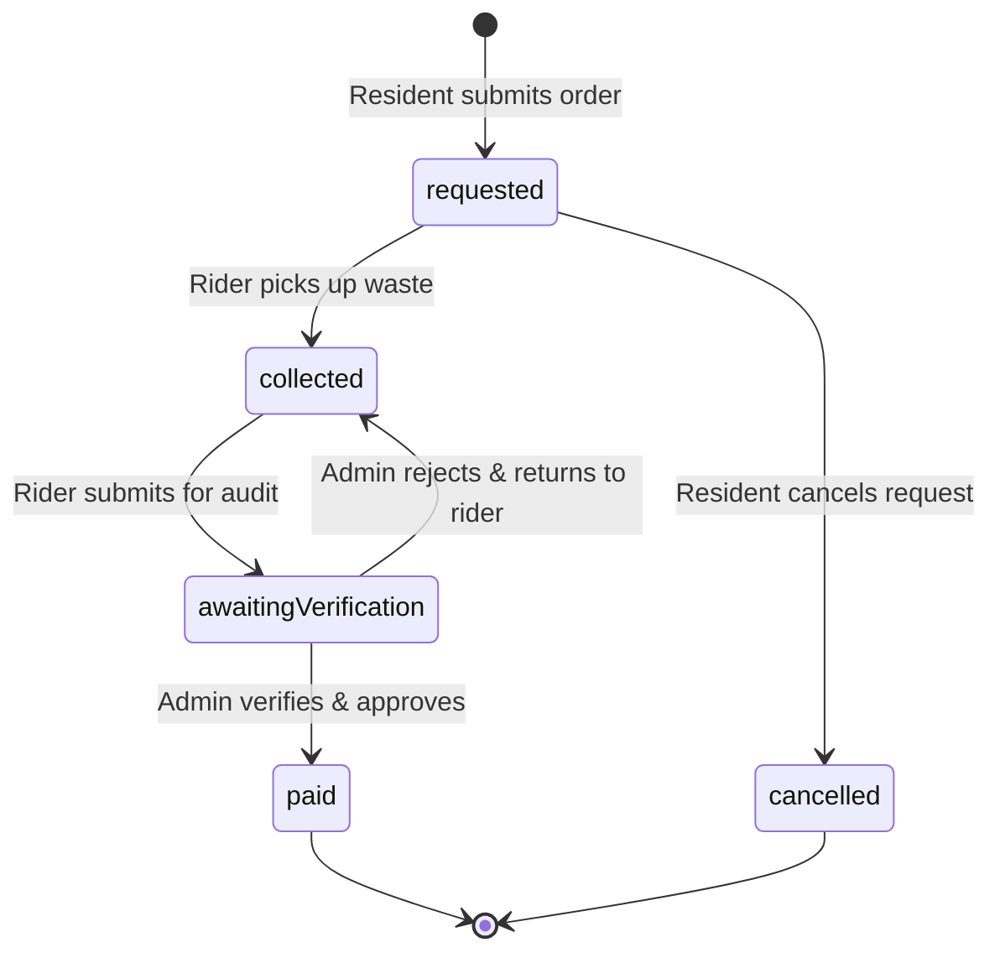

# Technical Documentation: EcoRoute System Architecture

## 1. System Architecture Overview
EcoRoute is engineered using Clean Architecture principles, ensuring strict separation of concerns across presentation, business domain logic, and data storage/networking layers.



### Directory Structure:
```
ecoRoute/
├── lib/
│   ├── app/                    # Application shell, router, and themes
│   │   ├── config/             # Constants (Arua coordinates, schedules, tariffs)
│   │   ├── theme/              # Material 3 light and dark green palette (CardThemeData)
│   │   ├── app.dart            # EcoRouteApp entry widget
│   │   └── router.dart         # Named routing and navigation generator
│   ├── core/                   # Infrastructure, services, and repositories
│   │   ├── services/           # WasteApiService, WasteDatabaseService, AuthService, LocationService, LanguageService
│   │   ├── utils/              # UGX and DateTime formatters
│   │   ├── pickup_request_repository.dart # Local storage CRUD
│   │   └── result.dart         # Sealed Result monad for error handling
│   ├── domain/                 # Pure Dart business rules and entities
│   │   ├── entities/           # PickupRequest, AppUser
│   │   ├── enums/              # RequestStatus, Role, WasteType, Zone
│   │   └── rules/              # PriceCalculator, ReminderPolicy, StatusMachine, ZoneResolver
│   ├── features/               # Presentation screens & modular components
│   │   ├── admin/              # Approval queues, transaction analytics
│   │   ├── auth/               # Role switcher and registration bottom sheet
│   │   ├── database/           # Municipal waste taxonomy & recycling sheet
│   │   ├── home/               # Dashboard, interactive map, schedule, weather safety
│   │   ├── payment/            # Mobile Money dialog & digital audit receipts
│   │   ├── request/            # Order creation with auto-camera scanner & GPS autofill
│   │   └── rider/              # Route stop tiles and status progression
│   └── main.dart               # App entrypoint with async dependency initialization
├── test/                       # 38 automated unit, mock, and widget tests across 9 suites
└── docs/                       # Complete 14-week project, test, user, and defence documentation
```

---

## 2. Domain Data Models & Entities

### `PickupRequest` Model:
| Field | Type | Description |
| :--- | :--- | :--- |
| `id` | `String` | Unique microsecond timestamp identifier |
| `wasteType` | `WasteType` | `household`, `tradingCenter`, `unknown` |
| `description` | `String` | Pickup location details and description ($\ge 10$ chars) |
| `sackCount` | `int` | Number of sacks to collect ($1 \le n \le 50$) |
| `priceUgx` | `int` | Total computed collection fee in Uganda Shillings |
| `zone` | `Zone` | `north`, `south`, `east`, `west` |
| `address` | `String` | Physical landmark or division name |
| `latitude` / `longitude` | `double?` | GPS coordinates acquired via Geolocator |
| `residentName` / `residentPhone` | `String` | Contact details for pickup coordination (Default: `+256394880352`) |
| `status` | `RequestStatus` | `requested`, `collected`, `awaitingVerification`, `paid`, `cancelled` |

### Open Waste Database Models (`WasteDatabaseService`):
1. **`WasteMaterial`:**
   - `id`: Unique identifier (e.g., `mat-pet`, `mat-hdpe`, `mat-battery`).
   - `name`: English descriptive title (e.g., *PET Beverage Bottles*).
   - `lugbaraName`: Indigenous Lugbara translation (*Kopo kopo kabi kabi*).
   - `category`: `WasteCategory` enum (*organic, plastic, paper, metal, glass, hazardous*).
   - `decompositionTime`: Estimated biodegradation period (*2 weeks to 1,000,000 years*).
   - `valuePerKgUgx`: Open market recycling resale rate in Uganda Shillings (e.g., 800 UGX/kg for PET, 4,500 UGX/kg for e-waste).
   - `co2SavedPerKg`: Carbon emission reduction achieved per kilogram recycled.
   - `sortingTip` & `recyclingTip`: Actionable municipal sorting instructions.
   - `isHazardous`: Boolean flag designating dangerous items requiring controlled drop-off.
2. **`RecyclingFacility`:**
   - 6 certified Arua recovery hubs (*Arua Central Market, River Oli, Arua Hill, Referral Hospital, Muni University, Ediofe*) with geographic coordinates, accepted streams, and operating hours.
3. **`MunicipalWasteBenchmark`:**
   - Official World Bank / NEMA open benchmarks: 0.44 kg/day/capita generation, 125 daily tons, 68.2% organic, 86% recyclable potential, 42.5% municipal collection coverage.

---

## 3. Finite State Machine Transitions



Transition enforcement function: `isValidTransition(currentStatus, targetStatus)`.

---

## 4. REST API Integration (`WasteApiService`)
- **Endpoint:** `https://api.open-meteo.com/v1/forecast?latitude=3.05&longitude=30.91&current_weather=true`
- **Method:** `HTTP GET` with 4-second timeout.
- **Payload Parsing:** Extracts `temperature`, `windspeed`, and WMO `weathercode`.
- **Business Logic:** Codes $51 \le c \le 99$ signify active rain or showers, triggering warning banners about impassable unpaved roads in Arua.
- **Failover Mechanism:** Returns offline cached guidelines whenever a `SocketException`, `TimeoutException`, or HTTP non-200 occurs.

---

## 5. Device Capability Integration (`LocationService` & `WasteCameraScanner`)
- **Geolocator GPS:** Configured in `AndroidManifest.xml` (`ACCESS_FINE_LOCATION`, `ACCESS_COARSE_LOCATION`). Resolves distance using Haversine approximation from center $(3.05^\circ, 30.91^\circ)$. If distance $\le 12$ km, calculates vector angle to assign Cardinal Zone.
- **Waste Camera Scanner:** Viewfinder features simulated real-time ultrasonic proximity detection. When distance decreases below 0.25m, the system auto-captures the photo, acquires GPS coordinates, and if `autoCompleteOnAutoCapture: true`, automatically saves and returns to the order screen.

---

## 6. Build Artifacts & Distribution
- **Debug Split APKs:** Located in `build/app/outputs/flutter-apk/` (split by ABI: `arm64-v8a`, `armeabi-v7a`, `x86_64`).
- **Production Release Split APKs:** Built with AOT compilation, native ARM machine code, icon tree-shaking (99.3% reduction), and minification:
  - `build/app/outputs/flutter-apk/app-arm64-v8a-release.apk` (166.6 MB)
  - `build/app/outputs/flutter-apk/app-armeabi-v7a-release.apk` (154.0 MB)
  - `build/app/outputs/flutter-apk/app-x86_64-release.apk` (167.7 MB)
